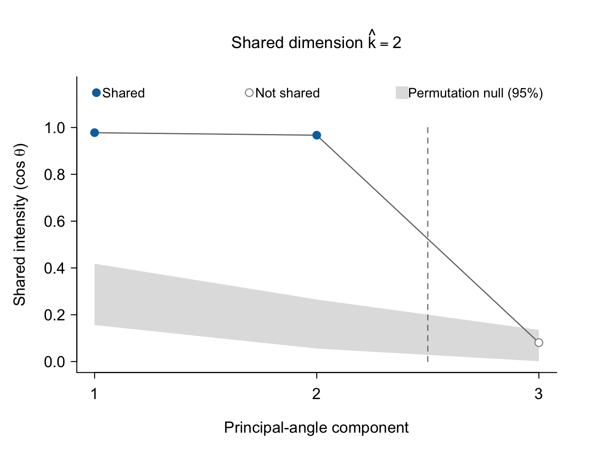

# RoDPAA

## Introduction

RoDPAA (Robust Dissimilarity-based Principal Angle Analysis) is an R package for unsupervised integration of high-dimensional multiview data. It identifies shared sample-level variation across two paired data views through principal-angle analysis of signal subspaces derived from sample dissimilarity matrices.

Unlike methods that require shared variation to occupy an identical subspace across views, RoDPAA allows corresponding latent directions to be partially aligned, recognizing that different data modalities may capture complementary aspects of the same underlying biological processes. By quantifying the strength of cross-view alignment and using permutation-based inference to identify statistically significant shared components, RoDPAA can recover coordinated variation that may be overlooked under an exact common-subspace assumption.

By operating on sample-level dissimilarities rather than the original feature matrices, RoDPAA accommodates user-specified dissimilarity measures, including Euclidean and non-Euclidean measures, and allows each data view to retain a geometry appropriate to its characteristics. This flexibility makes RoDPAA applicable to heterogeneous multiview data, including but not limited to microbiome, metabolomic, transcriptomic, and other high-dimensional biomedical measurements.

## Installation

Install the development version from GitHub:

``` r
# install.packages("remotes")
remotes::install_github("yanyanxu0428/RoDPAA", build_vignettes = TRUE)
```

## Usage

### Example 1: Simulated data

`rodpaa_example` contains two simulated views measured on the same 80
participants, generated with two shared latent factors (see
`?rodpaa_example`). RoDPAA takes one dissimilarity matrix per view. The signal
ranks are selected with the default variance rule.

``` r
library(RoDPAA)

D1 <- dist(rodpaa_example$view1)   # Euclidean distance, view 1
D2 <- dist(rodpaa_example$view2)   # Euclidean distance, view 2

set.seed(1)                        # the permutation test is random
fit <- rodpaa(D1, D2, input = "dissimilarity", rank_method = "variance")
#> Shared dimension selected by the permutation test: k = 2
fit
#> RoDPAA fit
#>   Participants:          80
#>   Signal ranks:          r1 = 3, r2 = 3
#>   Shared dimension:      k = 2 (permutation test)
#>   Shared intensities:    0.978, 0.967, 0.081

names(fit)                         # components of the fit
summary(fit)                       # permutation test for each component
plot(fit)                          # shared intensities
head(fit$shared_factors)           # one score per participant
```



The shared intensities are the cosines of the principal angles between the two
signal subspaces. 


### Example 2: Real data, ileal and rectal microbiome (IBDMDB)

`ibdmdb_micro` contains genus-level 16S rRNA gene counts from paired ileal and
rectal biopsies of 68 participants of the IBDMDB cohort (Lloyd-Price et al.,
2019). Each view can use its own dissimilarity. Here, Bray-Curtis dissimilarity
on the counts is used alongside Euclidean distance after the centered
log-ratio (CLR) transformation.

``` r
d <- ibdmdb_micro

# Bray-Curtis dissimilarity on the counts
set.seed(1)
fit_bc <- rodpaa(d$rectum, d$ileum, input = "data",
                 dissimilarity1 = "bray", dissimilarity2 = "bray")
#> Shared dimension selected by the permutation test: k = 11

# CLR transformation, then Euclidean distance
clr <- function(X) { L <- log(X + 1); L - rowMeans(L) }
set.seed(1)
fit_eu <- rodpaa(clr(d$rectum), clr(d$ileum), input = "data",
                 dissimilarity1 = "euclidean", dissimilarity2 = "euclidean")
#> Shared dimension selected by the permutation test: k = 19

plot(fit_bc)                       # shared intensities
plot(fit_bc, type = "scores")      # participant scores on SF1 and SF2
```

The two sites share 11 directions under Bray-Curtis dissimilarity and 19 under
CLR-Euclidean distance, with the signal ranks selected by the default variance
rule (80% of the eigenvalue sum).

### Example 3: Other input types

`rodpaa()` accepts each view in one of three forms:

``` r
rodpaa(D1, D2, input = "dissimilarity")      # dissimilarity matrices (default)
rodpaa(X1, X2, input = "data",               # data matrices, participants in rows
       dissimilarity1 = "bray", dissimilarity2 = "euclidean")
rodpaa(K1, K2, input = "kernel")             # similarity (kernel) matrices
```

With `input = "data"`, RoDPAA computes the dissimilarities internally, and
`dissimilarity1` and `dissimilarity2` select Euclidean distance (`"euclidean"`)
or Bray-Curtis dissimilarity (`"bray"`) for each view. For any other
data-appropriate dissimilarity, compute the dissimilarity matrices first and
supply them directly with `input = "dissimilarity"`. RoDPAA uses the data
exactly as supplied, so apply any preprocessing first.

## Learn more
  
* Tutorial: `vignette("Getting-started-with-RoDPAA", package = "RoDPAA")`
* Function reference: `?rodpaa`, `?plot.rodpaa`, `?dist_to_kernel`

## Citation

Xu Y, Wang Y. RoDPAA: a robust dissimilarity-based principal angle analysis
framework for multi-view microbiome data integration. Manuscript in
preparation.
